<div align="center">


<br/>


**A from-scratch blockchain implementation with proof-of-work mining, ECC wallets and UTXO transactions, complete with a real-time web dashboard.**
<br/>Mine blocks · explore the chain · create secp256k1 wallets · send signed transactions.

</div>

---

## 🎬 Live demo

<div align="center">
  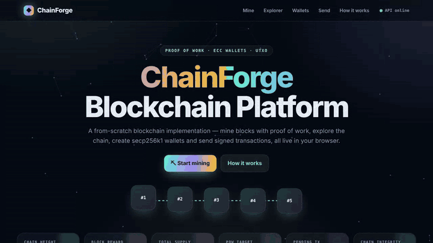
  <br/><sub>Real recording of the app: mine a block → validate the chain → tamper test → create a wallet → sign & send a transaction.</sub>
</div>

<div align="center">
  
</div>

---

## 📚 Table of contents

1. [Features](#-features)
2. [Quick start (one command)](#-quick-start-one-command)
3. [Manual setup](#-manual-setup)
4. [A tour of the dashboard](#-a-tour-of-the-dashboard)
5. [Command-line usage](#-command-line-usage)
6. [REST API](#-rest-api)
7. [Architecture & project structure](#-architecture--project-structure)
8. [How it works under the hood](#-how-it-works-under-the-hood)
9. [Data files & block format](#-data-files--block-format)
10. [Tests](#-tests)
11. [Troubleshooting](#-troubleshooting)
12. [Limitations & roadmap](#-limitations--roadmap)
13. [License](#-license)

---

## ✨ Features

| | Feature | Details |
|---|---|---|
| ⛏ | **Proof of Work mining** | SHA-256 nonce search until the block hash starts with `0000`. Animated mining console shows the nonce counter and the hash locking in. |
| 🔗 | **Persistent blockchain** | Chain stored on disk (`Data/forgecoin-blockchain`), genesis block created automatically. Duplicate block heights are rejected. |
| 🛡 | **Chain validation** | Re-computes every hash, checks `prev_block_hash` links, heights and the PoW target. Animated block-by-block verification. |
| 🧪 | **Tamper test** | Change a block's timestamp in the browser and watch the hash stop matching (nothing is saved). |
| 🔑 | **ECC wallets** | secp256k1 key pairs, Base58Check addresses (`hash160` + checksum), written by hand — no crypto wallet libraries. |
| 💸 | **UTXO transactions** | Inputs picked from unspent outputs, change returned, flat **1 FRG** fee, P2PKH script, **ECDSA signatures verified** after signing. |
| 🪙 | **Coinbase reward** | Every block pays **50 FRG** to the miner address you choose. |
| 🌐 | **REST API** | Tiny pure-standard-library Python server (no Flask needed) — 11 JSON endpoints. |
| 🎨 | **Multi-page animated UI** | Separate pages for Mine, Explorer, Wallets, Send and How it works (Next.js 14 + Framer Motion): count-up stats, spring-animated blocks, flowing links, particle network background, transaction-anatomy diagram. |
| 📱 | **Responsive** | Works on phones, tablets and desktops. |

> **Coin:** ForgeCoin (`FRG`) · 1 FRG = 100,000,000 shards · block reward 50 FRG · flat fee 1 FRG

---

## 🚀 Quick start (one command)

**Requirements:** [Python 3.9+](https://www.python.org/downloads/) and [Node.js 18+](https://nodejs.org/) (npm included).

### Windows (PowerShell or CMD)

```powershell
.\run.bat
```

### Linux / macOS / Git Bash

```bash
chmod +x run.sh
./run.sh
```

The script will, on the first run only:

1. create a Python virtual environment (`venv/`) and install `pycryptodome`,
2. add two demo wallets (`Data/forgecoin-account`),
3. run `npm install` for the frontend,

then start the **API on http://127.0.0.1:8765** and the **website on http://localhost:3000** — open the website and click **⛏ Start mining**.

---

## 🔧 Manual setup

Run everything from the **project root** (the folder that contains `Blockchain/`).

<details open>
<summary><b>Windows PowerShell</b></summary>

```powershell
# 1) Python backend
python -m venv venv
Set-ExecutionPolicy -Scope Process -ExecutionPolicy RemoteSigned
.\venv\Scripts\Activate.ps1
pip install -r requirements.txt
mkdir Data -ErrorAction SilentlyContinue
copy Data\forgecoin-account.sample Data\forgecoin-account     # 2 demo wallets (skip if you have your own)
python -m Blockchain.Api.server                                # -> http://127.0.0.1:8765

# 2) Frontend - open a SECOND terminal
cd frontend
npm install
npm run dev                                                    # -> http://localhost:3000
```
</details>

<details>
<summary><b>Linux / macOS</b></summary>

```bash
# 1) Python backend
python3 -m venv venv && source venv/bin/activate
pip install -r requirements.txt
mkdir -p Data && cp -n Data/forgecoin-account.sample Data/forgecoin-account
python -m Blockchain.Api.server                 # -> http://127.0.0.1:8765

# 2) Frontend - in a second terminal
cd frontend && npm install && npm run dev       # -> http://localhost:3000
```
</details>

**Production build of the website:** `cd frontend && npm run build && npm start`.

**Different backend address?** Set `API_URL`, e.g. `API_URL=http://192.168.1.20:8765 npm run dev` — the Next.js server proxies `/api/*` to it, so there are no CORS problems.

---

## 🖼 A tour of the website

Every feature has its own page, reachable from the top navigation.

| Page | URL | What you can do |
|---|---|---|
| **Home** | `/` | Live chain statistics, quick links and the latest blocks |
| **Mine** | `/mine` | Run proof of work and pick who receives the reward |
| **Explorer** | `/explorer` | Browse blocks, validate the chain, run the tamper test |
| **Wallets** | `/wallets` | Create wallets and see UTXO-based balances |
| **Send** | `/send` | Sign and verify transactions, view the pending list |
| **How it works** | `/how-it-works` | Hashing, PoW, ECC keys, addresses, UTXO, signatures |

### Home
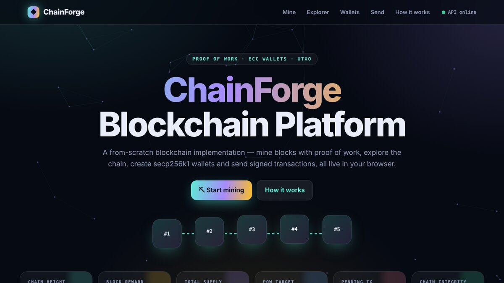

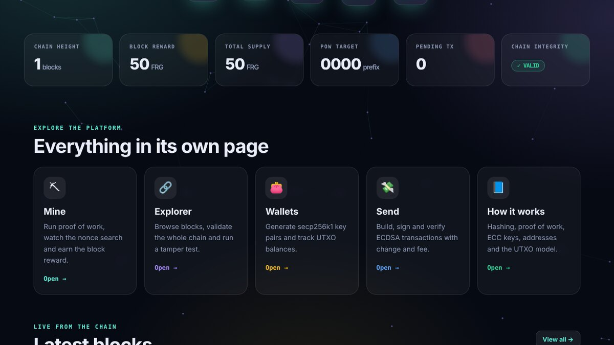

### Mine — proof of work
Pick the reward address and press **Mine next block**. While the server searches, random hashes flicker; when a block is found the nonce counts up to the real value and the winning hash locks in with its leading zeros highlighted, together with attempts, time and hash rate.

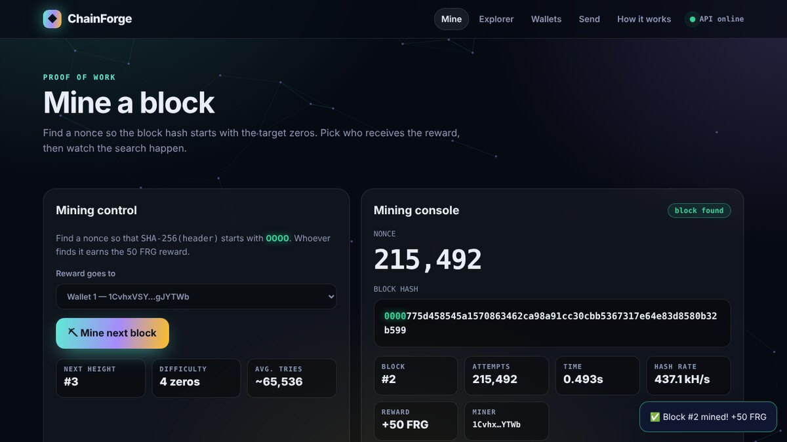

### Explorer — validate & tamper test
Blocks are linked by animated connectors. **Validate chain** lights each block green (or red) one after another. Click a block for every header field, the coinbase transaction and the raw JSON.

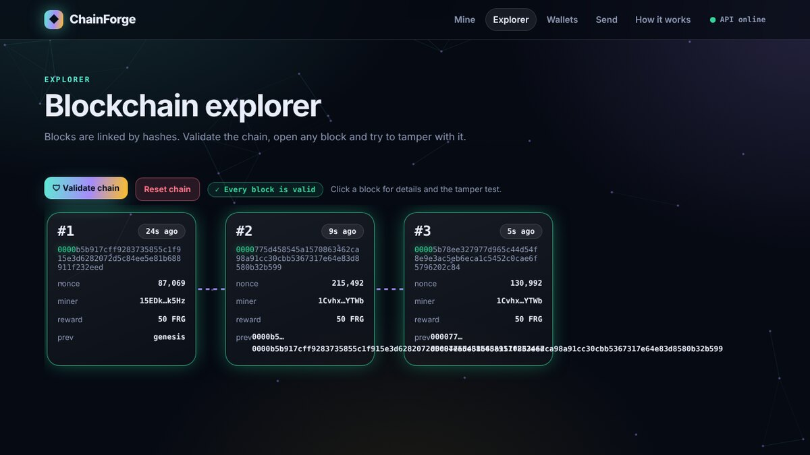

Inside a block, change the timestamp and the recomputed SHA-256 no longer matches — exactly why a blockchain is tamper-evident (the change only exists in your browser).

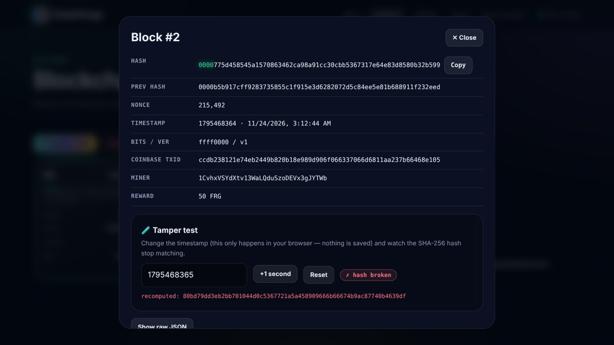

### Wallets
Create secp256k1 wallets, copy addresses, and use **Mine a block to this wallet** to earn your first coins. Balances are computed from the UTXO set.

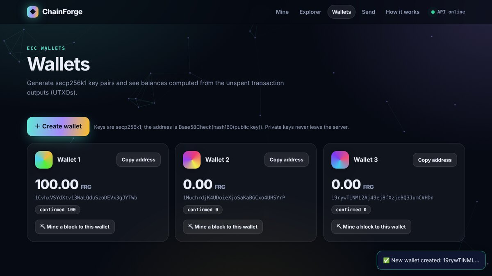

### Send — signed transactions
Choose sender, receiver and amount. The *transaction anatomy* view animates inputs → transaction → outputs (payment, change, fee) and shows whether the ECDSA signature verified.

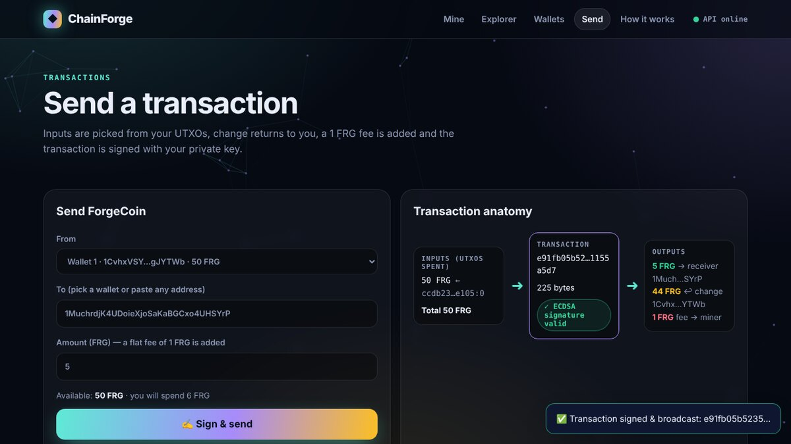

### How it works
Scroll-reveal cards explain hashing, proof of work, ECC keys, addresses, the UTXO model and signatures.

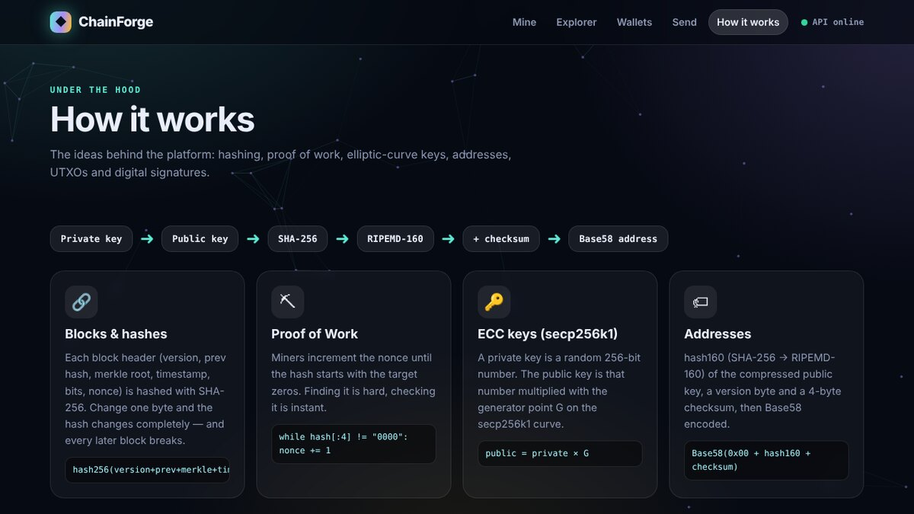

---

## 💻 Command-line usage

The original command-line tools still work (run from the project root, with the venv active):

```bash
python -m Blockchain.Client.account       # create a new wallet -> appended to Data/forgecoin-account
python -m Blockchain.main                 # mine 2 blocks, print the chain and "Chain valid: True"
python -m Blockchain.Client.send_coin     # build + sign a demo transaction and print its Transaction ID
python -m Blockchain.Api.server           # start the REST API (add --port 9000 to change the port)
```

> Always use `python -m ...` from the project root — running a file directly gives `ModuleNotFoundError: Blockchain`.

---

## 🌐 REST API

Base URL: `http://127.0.0.1:8765` · all bodies are JSON · errors look like `{"error": "message"}`.

| Method | Endpoint | Body | Description |
|---|---|---|---|
| GET | `/api/health` | – | Liveness check |
| GET | `/api/status` | – | Height, last hash, target, reward, fee, supply, validity, pending count |
| GET | `/api/blocks` | – | Summary of every block |
| GET | `/api/blocks/{height}` | – | One block: `summary` + `raw` stored JSON |
| POST | `/api/mine` | `{"miner": "<address>"}` *(optional)* | Mine the next block, returns block + attempts + seconds + hash rate |
| GET | `/api/validate` | – | Per-block validation report |
| GET | `/api/wallets` | – | Wallets with confirmed / available / pending balances (**private keys are never returned**) |
| POST | `/api/wallets` | – | Create a wallet |
| POST | `/api/send` | `{"from","to","amount"}` | Build, sign and verify a transaction → mempool |
| GET | `/api/mempool` | – | Pending transactions |
| POST | `/api/reset` | – | Delete the chain and create a new genesis block |

```bash
curl http://127.0.0.1:8765/api/status
curl -X POST http://127.0.0.1:8765/api/mine -d '{}'
curl -X POST http://127.0.0.1:8765/api/send -d '{"from":"1Cvhx...","to":"1Much...","amount":5}'
```

---

## 🏗 Architecture & project structure

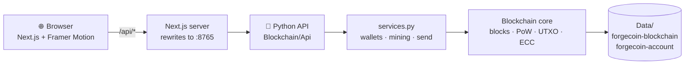

```
chainforge/
├── README.md
├── run.sh / run.bat              # one-command launchers
├── requirements.txt              # pycryptodome (RIPEMD-160)
├── Blockchain/                   # ── Python backend ──
│   ├── config.py                 # coin name, target, reward, units
│   ├── main.py                   # CLI: mine 2 blocks + print + validate
│   ├── Api/
│   │   ├── server.py             # HTTP server (stdlib only)
│   │   └── services.py           # wallets, mining, send, validation helpers
│   ├── Client/
│   │   ├── account.py            # wallet generation (ECC keys -> address)
│   │   └── send_coin.py          # UTXO selection, outputs, fee, signing
│   └── Backend/
│       ├── Core/
│       │   ├── blockchain.py     # chain, mining, validate_chain()
│       │   ├── block.py · blockheader.py
│       │   ├── tx.py             # Tx / TxIn / TxOut / CoinbaseTx, signing
│       │   ├── script.py         # P2PKH script
│       │   ├── utxo.py           # balances from the chain
│       │   ├── Database/database.py
│       │   └── EllepticCurve/    # secp256k1: field, point, ECDSA
│       └── Util/util.py          # hashes, Base58, varints
├── frontend/                     # ── Next.js website ──
│   ├── app/                      # pages: / · mine · explorer · wallets · send · how-it-works
│   ├── components/               # Shell (nav), AppProvider (shared data), Miner, Explorer, Wallets, Send…
│   └── lib/api.js
├── Data/                         # runtime data (ignored by git except the sample wallets)
├── tests/                        # unit tests
└── docs/                         # README images / animations
```

---

## 🔬 How it works under the hood

### 1. Block header & hashing
```text
hash = SHA-256( version + prev_block_hash + merkle_root + timestamp + bits + nonce )
```
Changing any field changes the hash completely, and because the next block stores this hash in `prev_block_hash`, tampering breaks every later block.

### 2. Proof of Work
`BlockHeader.mine("0000")` increments the nonce until the hash starts with `0000` (≈ 65,536 tries on average). Verifying takes a single hash.
> The nonce is incremented *after* hashing, so the accepted hash was computed with `nonce - 1` — `validate_chain()` accounts for this.

### 3. Keys & addresses (secp256k1)
```text
private key  = random 256-bit integer
public key   = private key × G           (elliptic-curve point multiplication)
hash160      = RIPEMD-160( SHA-256( compressed public key ) )
address      = Base58( 0x00 + hash160 + first 4 bytes of SHA-256(0x00 + hash160) )
```

### 4. UTXO model & transactions
There are no account balances. A balance is the sum of unspent outputs locked to your `hash160`.
```text
inputs (UTXOs you spend)  =  payment  +  change (back to you)  +  fee
```
Each input's `script_sig` holds `<signature> <public key>`; each output's `script_pubkey` is `OP_DUP OP_HASH160 <hash160> OP_EQUALVERIFY OP_CHECKSIG` (P2PKH).

### 5. Signing & verification
The transaction hash `z` (SIGHASH_ALL) is signed with ECDSA using a deterministic nonce (RFC 6979). The API immediately verifies the signature with the public key **and** checks that the key hashes to the sender's address.

### 6. Chain validation
For every block: height is sequential · genesis points to the zero hash · `prev_block_hash` equals the previous block's hash · the recomputed hash equals the stored hash · the hash meets the target.

---

## 🗂 Data files & block format

| File | Content |
|---|---|
| `Data/forgecoin-blockchain` | The whole chain as one JSON line |
| `Data/forgecoin-account` | Wallets `{privateKey, PublicAddress}` — **private keys! never commit or share** (git-ignored) |
| `Data/forgecoin-account.sample` | Two throw-away demo wallets used by the launchers on first run |

A stored block:

```json
{
  "Height": 2,
  "Blocksize": 1,
  "BlockHeader": {
    "version": 1,
    "prev_block_hash": "0000d5a53043b7ebe045f4a0a06eba24931cc3a9f78b492736f10833629c0afc",
    "merkle_root": "",
    "timestamp": 1795464760,
    "bits": "ffff0000",
    "nonce": 47118,
    "blockHash": "0000755503ca4b1b7724adad35bb62c3e140260a0594f81edafd078fcfdf6649"
  },
  "Txs": {
    "version": 1,
    "tx_ins":  [{ "prev_tx": "00…00", "prev_index": 4294967295, "script_sig": { "cmds": [2] }, "sequence": 4294967295 }],
    "tx_outs": [{ "amount": 5000000000, "script_pubkey": { "cmds": [118, 169, "82d19e59…7e34", 136, 172] } }],
    "locktime": 0,
    "TxId": "ccdb2381…e105"
  }
}
```
`amount` is in **shards** (5,000,000,000 shards = 50 FRG). Set the `FORGE_DATA_DIR` environment variable to use a different data folder.

---

## 🧪 Tests

```bash
python -m unittest discover -s tests -v
```

Covers: genesis + mining, tamper detection, duplicate-height rejection, signed transactions (change, fee, signature check, pending balances) and insufficient-balance errors. Tests use a temporary data folder — your real chain and wallets are never touched.

---

## 🩹 Troubleshooting

| Problem | Fix |
|---|---|
| `Python was not found; run without arguments to install from the Microsoft Store` | Python is not really installed (Windows only has a Store shortcut). Install it from [python.org](https://www.python.org/downloads/) and **tick “Add python.exe to PATH”**, then open a new terminal and run `.\run.bat` again |
| `ModuleNotFoundError: Blockchain` | Run from the project root with `python -m Blockchain...` |
| `No module named 'Crypto'` | `pip install -r requirements.txt` (inside the venv) |
| Website shows **“Cannot reach the ChainForge API”** | Start the API: `python -m Blockchain.Api.server`. With the launcher, read the error in the **“ChainForge API”** window. The banner disappears by itself once the API is up |
| `Address already in use` / port 3000 or 8765 busy | Stop the other program, or use `--port 9001` (API) and start the website with `API_URL=http://127.0.0.1:9001 npm run dev` |
| PowerShell blocks `Activate.ps1` | `Set-ExecutionPolicy -Scope Process -ExecutionPolicy RemoteSigned` |
| `Insufficient balance` | A transfer needs *amount + 1 FRG fee*. Use **Mine a block to this wallet** first |
| Want a fresh chain | Click **Reset chain** in the Explorer, or delete `Data/forgecoin-blockchain` |
| “private key not stored here” | The sender wallet must exist in `Data/forgecoin-account` |

---

## ⚠️ Limitations & roadmap

ChainForge is an **educational** project. Be aware that:

- 🔒 Not for real money — wallet keys are stored in a plain JSON file, there is no encryption or authentication on the API.
- 🌍 Single node: there is no peer-to-peer networking or consensus between machines.
- 🧾 Blocks store only the **coinbase** transaction. Signed user transactions are verified and kept in the in-memory **mempool** (cleared on restart); the merkle root is empty.
- ⚙️ Fixed difficulty (`0000`) and fixed reward (no halving).

**Ideas for next steps:** include mempool transactions in mined blocks + Merkle root · difficulty adjustment & reward halving · P2P node sync over TCP · transaction script validation (`OP_CHECKSIG`) before mining · persistent mempool.

---

## 📄 License

[MIT](LICENSE) — free to use, learn from and extend.

<div align="center"><sub>Built with ❤️ using Python, Next.js and Framer Motion.</sub></div>
